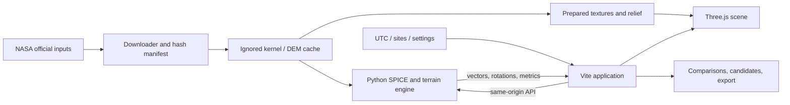

# Architecture
A browser WebGL experience uses a local Python science service. Three.js/Vite and plain JavaScript keep editing simple; SpiceyPy exposes established NAIF computations. No database, authentication or paid API is needed.

## Responsibilities
- science/server.py: loopback GET API with JSON errors. Requests run on threads; only SPICE calls share a lock, and long calculations check whether the client is still connected.
- engine.py: kernels, UTC→ET, vectors/rotations, surface/DSN geometry, power, summaries and candidate screening.
- terrain.py: real elevation sampling, local basis, regional slope and cached horizon profiles.
- web/app.js: application state (time, window, sites, view, focus, screen), API calls, latest-wins state sync, playback, URL state, keyboard shortcuts and layout sync.
- web/panels.js: DOM rendering for site cards, sky charts, window lanes, station table, Discover results and sources (text nodes only).
- web/lessons.js: guided tour steps driven through app actions; exiting restores the user's setup.
- web/scene.js: textures/relief/polar shading, body rotations, persistent markers, decluttered labels, eased camera moves, picking and render-on-demand.
- web/contracts.d.ts: response documentation; Python performs runtime request validation.
- scripts/dev.mjs: checks generated assets, starts or reuses a matching API version, then starts Vite.
- scripts/setup.ps1: locked dependencies, data verification, assets, checks and build.

## State and rendering
The API returns km vectors in a Moon-centered J2000 scene and fixed-to-J2000 matrices. The renderer converts to right-handed Y-up axes and divides by 1737.4 km. Meshes and markers share the same frame transforms. Physical state never changes with illustrative display scaling. The Moon mesh has unexaggerated but finite-sampled LOLA relief.

Time changes calculate fresh SPICE states. The browser keeps at most one state request in flight and always converges on the latest slider position; playback advances only after each state is applied (about nine steps per second). Window summaries are separate bounded requests; adding a site fetches only that site. Candidate results re-screen automatically when the time settles and invalidate when criteria change. Camera transitions and damping smooth navigation only; no invented orbit drives the scene.

## Storage, performance, failures
Raw data and generated assets are ignored in Git. Committed manifests record URLs/hashes/size/acquisition time. Data are acquired at setup, not while handling a scientific request. Geometry caches 256 dates; terrain caches 512 profiles. Requests share one lock because SPICE has process-global state. Scans use 25 grid points; timelines allow at most 745 timestamps.

Missing required inputs prevent startup. Invalid requests return 400, unknown endpoints 404, calculation errors 500. The browser reports errors, shows a banner when the service is unreachable, and retains the last successful display; it never substitutes fictional results.

The scene renders only when the camera, state or labels change. Markers persist across time steps; label placement avoids overlaps by priority (bodies, selected sites, candidates, stations).

## Deployment
Vite listens on 127.0.0.1:5173 and proxies /api to 127.0.0.1:8000 in dev and production-preview modes. dist contains only browser assets.

Public hosting requires verified data and a Python runtime, same-origin HTTPS serving of dist and /api, a production service adapter/reverse proxy, bounded queues, rate limits and monitoring. Do not expose the local development HTTP server directly. GitHub Pages alone cannot run the engine. No deployment has been performed.

The screenshot references guide the subtle overlays and immersive scene. Their copied Artemis mission content is not part of this app. Three real DSN antennas are included, not the entire global station network.
